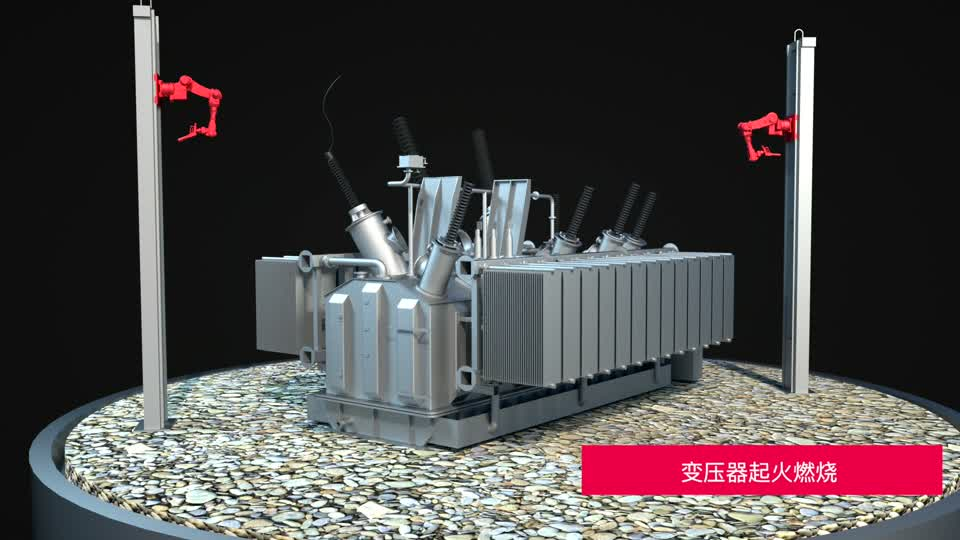
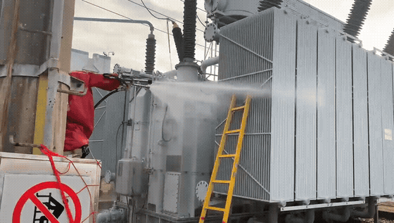
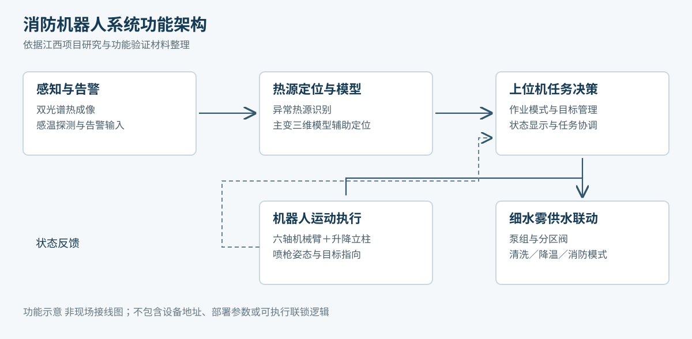
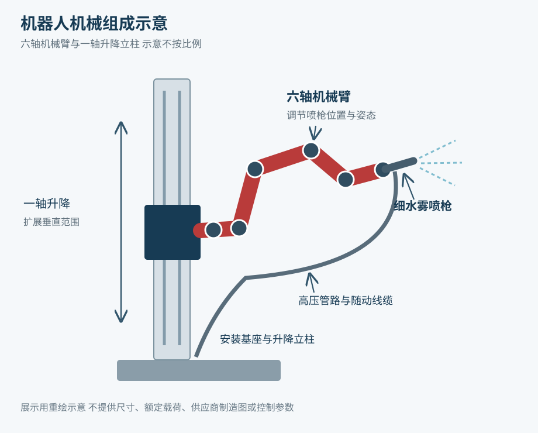
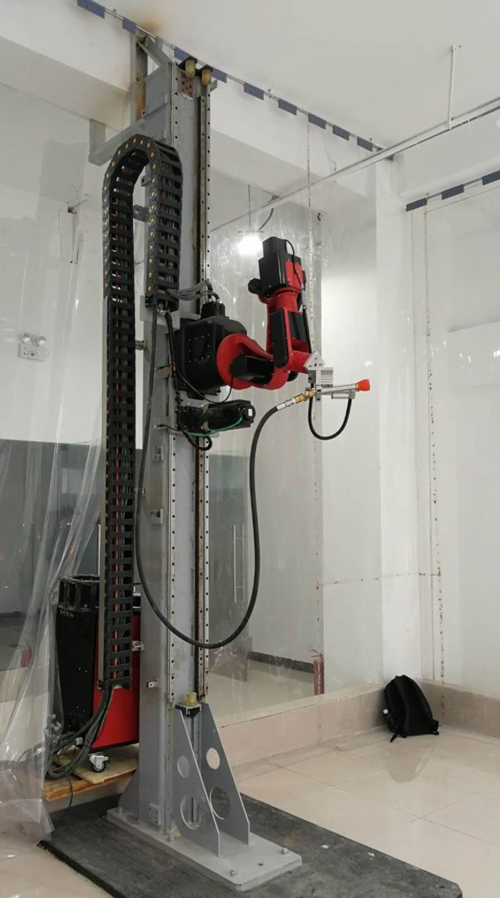
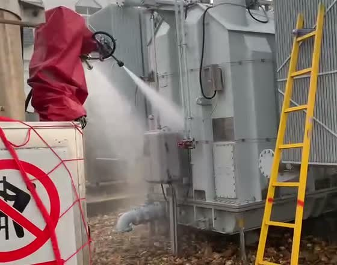

# 变电站高压细水雾消防机器人

将异常热源感知、机器人定向作业与高压细水雾消防联动连接起来的工程项目展示。整理人：**郑晓东**。

[在线项目展厅](https://sheldon123z.github.io/substation-firefighting-robot/) · [项目说明](docs/project-overview.md) · [系统结构](docs/architecture.md) · [个人贡献](docs/contributions.md) · [验证记录](docs/validation.md) · [全部影像](docs/media.md)

**[观看51秒工作原理动画](https://sheldon123z.github.io/substation-firefighting-robot/#intro-video)**

> 首屏动画直观展示机器人结构及清洗、降温和灭火工作模式。动画、实验室记录与现场试验分别标注；指标保留原试验条件。

## 项目做什么

变电站主变压器结构复杂，异常热源的位置与可达性会影响定向处置。项目把双光谱热成像、感温探测、主变三维模型、机器人运动控制及泵组联动整合起来，支持监测、清洗、降温与灭火等工作模式。

本仓库以**江西项目的系统集成和工程验证**为主体，补充介绍**惠州项目的后续研发**。两者的测试结果和完成阶段分别呈现。

| 项目 | 展示重点 | 材料阶段 |
| --- | --- | --- |
| 江西高压细水雾智能机器人灭火系统 | 七轴运动系统、热源定位、定向喷射、上位机和消防联动 | 研究报告定稿与现场功能验证记录 |
| 惠州主变压器火灾风险感知与机器人研发 | 红外与深度视觉、三维恢复、轨迹规划、风险预警 | 2024年3月阶段总结 |

## 看演示

| 视频 | 内容 | 观看 |
| --- | --- | --- |
| 三维作业动画 | 清洗、降温和灭火模式示意，约51秒 | [播放](https://sheldon123z.github.io/substation-firefighting-robot/#intro-video) / [MP4](docs/assets/videos/operation-animation.mp4) |
| 现场设备喷雾 | 30秒设备近景，无人物特写 | [播放](https://sheldon123z.github.io/substation-firefighting-robot/#videos) / [MP4](docs/assets/videos/field-spray.mp4) |
| 机械臂与立柱动作 | 实验室装置动作记录，约14秒 | [MP4](docs/assets/videos/robot-motion.mp4) |
| 热源跟踪 | 实验室红外阈值图像记录，60秒 | [MP4](docs/assets/videos/thermal-tracking.mp4) |
| 三维模型漫游 | 设备模型可视化，约19秒 | [MP4](docs/assets/videos/digital-model.mp4) |

动画用于说明工作原理；实验室红外录像展示热源图像变化，不能单凭录像得出现场定位精度。在线展厅提供原生视频播放器，全部视频可直接下载。

## 系统结构

机器人由**六轴机械臂和一轴升降立柱**组成。监测端发现异常后，上位机结合模型与工作模式生成作业任务；机器人执行定向运动，泵组与分区阀完成喷射联动，并反馈运行状态。

结构图依据项目材料重新绘制，表达功能与机械组成，不包含现场坐标、详细接线或设备配置。

## 现场与实验室

| 实验室装置 | 现场喷枪近景 |
| --- | --- |
|  |  |

## 工程验证

| 验证项 | 记录结果 | 条件与含义 |
| --- | --- | --- |
| 热源定位跟踪 | 误差在10厘米以内 | 主变停电，约100℃热水作为模拟热源 |
| 空喷有效距离 | 15米，最大约20米 | 空喷试验，不等同带电灭火能力认证 |
| 泵组工作压力 | 平均11兆帕 | 当次功能验证记录 |
| 消防联动 | 信号至分区控制阀开启约26秒 | 明确计时终点，非完整火灾处置耗时 |

以上为江西项目报告记录；惠州阶段测试与专利论文进展详见[验证记录](docs/validation.md)。

## 我承担的工作

- 机器人机械臂控制方法研究、研究报告与相关专利撰写。
- 现场问题分析，提出控制箱与立柱控制集成、通信和状态反馈改进方案。
- 推进上位机可视化与现场软硬件适配，协调科研任务和工程测试。
- 在后续惠州项目中参与多单位协同、成果规划与项目材料组织。

[个人贡献说明](docs/contributions.md)分别列出个人履历陈述、署名设计建议与项目团队成果。原系统的部署算法以项目材料为准，个人算法研究不直接等同于现场已部署控制器。

## 资料导航

| 文件 | 内容 |
| --- | --- |
| [项目概览](docs/project-overview.md) | 工程问题、两个项目的关系与工作范围 |
| [系统架构](docs/architecture.md) | 感知、决策、执行及反馈；机械组成 |
| [验证记录](docs/validation.md) | 指标、条件、来源及阶段成果 |
| [个人贡献](docs/contributions.md) | 职责、署名建议和团队成果边界 |
| [影像目录](docs/media.md) | 每张照片和每段视频的来源、用途 |
| [来源索引](docs/sources.md) | 研究报告、功能试验及阶段汇报索引 |
| [媒体清单](docs/assets-manifest.json) | 影像来源文件名、派生处理与SHA-256 |

## 本地查看

这是纯静态展示仓库，无需安装依赖。在仓库目录执行 `python3 -m http.server 8000 --directory docs`，再打开 `http://localhost:8000`。也可以直接打开 `docs/index.html`。

## 使用说明

本仓库用于个人工程经历展示，包含整理后的说明、示意图与精选影像，不提供机器人生产控制软件。原始项目影像、产品标识、研究成果与相关知识产权归原权利人；仓库公开不代表授权复制制造、商业使用或再分发原始资料。原始报告、合同、签章、现场详细接线及采购财务资料不在发布内容中。
