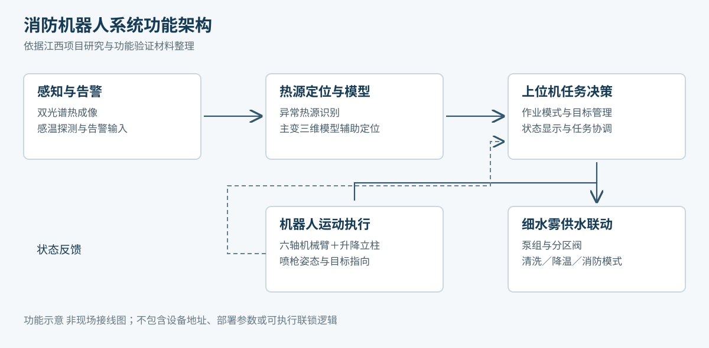
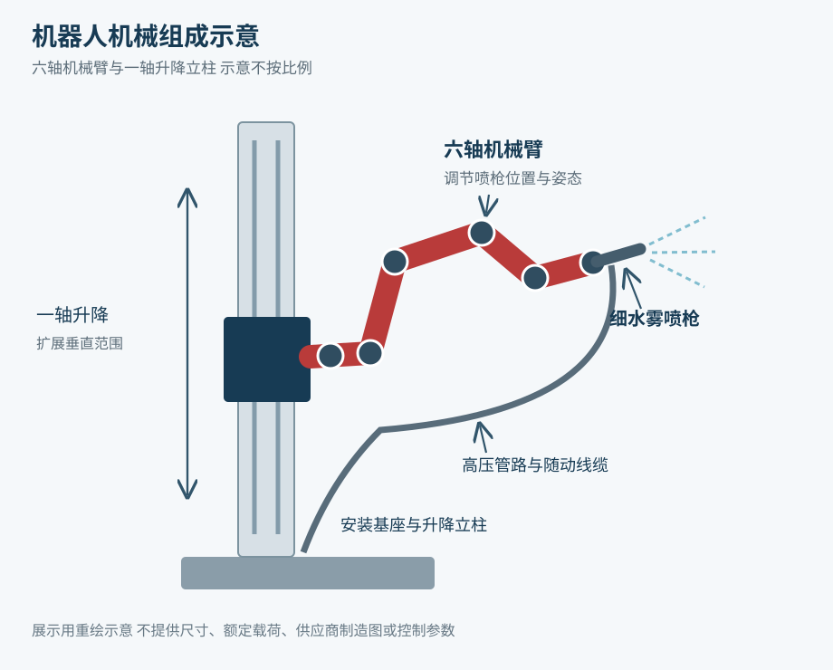

# 系统架构与机械组成

本页以江西项目研究报告与功能验证记录为依据，说明消防机器人如何从感知走向定向作业。图为展示用重绘示意，不是工程施工或控制接线图。[来源 S1、S2](sources.md)

## 功能架构

| 环节 | 功能 | 主要输出 |
| --- | --- | --- |
| 感知 | 双光谱摄像机、感温探测获取热源与告警信息 | 热源图像、异常位置、告警信号 |
| 分析 | 结合设备三维模型与热源位置进行判断 | 作业对象、任务位置、工作模式 |
| 决策 | 上位机管理清洗、降温和消防任务，联动控制单元 | 机器人运动任务及泵阀联动指令 |
| 执行 | 机械臂与升降立柱调整喷枪姿态，泵组和分区阀提供细水雾 | 定向喷射与相应作业动作 |
| 反馈 | 采集机器人、泵组和阀门状态 | 状态显示、异常提示及任务反馈 |

现场安全联锁及操作规程属于实际工程系统的专门设计内容，本页不提供可直接执行的控制逻辑。

## 机械结构

系统以六轴机械臂实现多方向姿态调整，升降立柱扩展竖直工作范围，形成六轴加一轴的运动组成。喷枪和高压管路安装于机器人末端，立柱及安装支架承载机器人，拖链用于线缆和管路随动布置。

现场喷雾图与实验室装置图对应不同场景，不依据照片反推额定负载、整机工作空间或消防安全距离。机械示意未包含制造尺寸和供应商原始CAD文件。

## 研发延伸

惠州项目的阶段研究增加了红外图像和深度视觉配准、异常区域三维恢复、运动学建模及避障轨迹规划。该阶段的样机安装与高度集成仍列为下一步工作，不能与江西已有功能验证合并成同一套验收成果。[来源 S4](sources.md)
